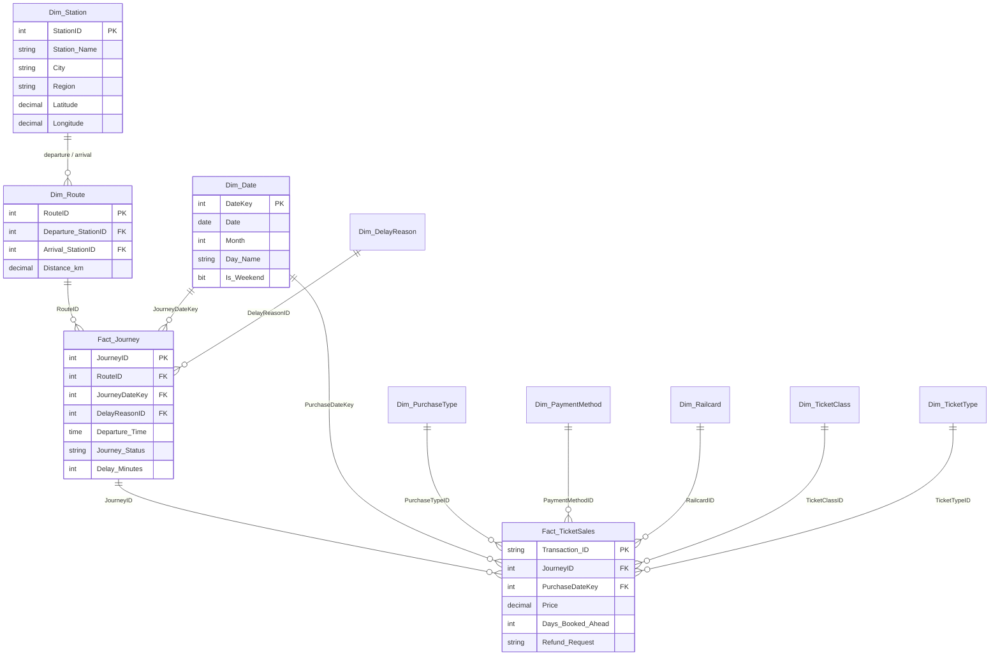
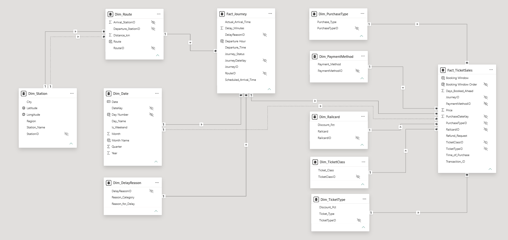

# UK Train Rides: Data Analysis and Business Intelligence


Graduation project for the Data Analysis track of the Digital Egypt Pioneers Initiative (DEPI).

We analyze four months of UK railway ticket data (January to April 2024) as if we were the analytics team of a train company. The goal is to understand sales, passenger demand, train performance, and refund requests, and to turn that into clear recommendations.

The work is descriptive and diagnostic. There is no forecasting or machine learning in this project.

## Team

1. Seif Osama SayedAhmed Fayed
2. Abdelrahman Hossam Hassan Hosny
3. Ibrahim Mohamed Ibrahim Azzazy
4. Mariz Morcos Gergis Michael

## Workflow

```
railway.csv  ->  Python (pandas)  ->  11 tables (star schema)  ->  SQL Server  ->  Power BI (4 pages)
```

| Step | Tool | What happens |
|---|---|---|
| 1. Data profiling | Python | Check the raw data without changing it |
| 2. Cleaning and modeling | Python | Clean the data and build 9 dimension tables and 2 fact tables |
| 3. Database | SQL Server | Create the tables with keys and constraints, load the data, check it with SQL queries |
| 4. Design | Figma | Design the layout of the four dashboard pages |
| 5. Dashboards | Power BI | Build the data model, DAX measures and four report pages |
| 6. Insights | - | Write findings and recommendations |

## The data

- `railway.csv`: 31,653 rows and 18 columns. One row is one ticket.
- The tickets belong to 19,871 train journeys, on 65 routes between 32 stations.
- `railway_data_dictionary.csv` explains every column.
- `orr_station_attributes.ods` is the official station file from the Office of Rail and Road (ORR). We use it for each station's region and coordinates, and to calculate the straight-line distance of each route.

**Ticket level vs journey level.** One train journey can have many tickets. Sales and demand are counted per ticket, but delays and cancellations are counted per journey. This is why the model has two fact tables. For example, 5.9% of tickets were on cancelled trains, but only 4.0% of journeys were cancelled.

## Data model

Star schema with 11 tables:

- **Fact tables:** `Fact_TicketSales` (31,653 tickets) and `Fact_Journey` (19,871 journeys). Each ticket is linked to its journey by `JourneyID`.
- **Dimension tables:** `Dim_Station`, `Dim_Route`, `Dim_Date`, `Dim_TicketType`, `Dim_TicketClass`, `Dim_Railcard`, `Dim_PaymentMethod`, `Dim_PurchaseType`, `Dim_DelayReason`.



The same model as it looks in Power BI (12 relationships, all one-to-many):



The full table design is in `docs/UK_Train_Rides_Schema.docx`. We added `Latitude` and `Longitude` to `Dim_Station` for the map in Power BI.

## Main cleaning decisions

- No rows were deleted. Empty values in this data have a meaning:
  - An empty railcard means the passenger had no railcard. We stored it as `None`.
  - An empty actual arrival time only happens on cancelled journeys.
  - An empty delay reason only happens on journeys that were on time. We stored it as `No Delay`.
- Delay reasons written in two ways were merged (for example `Signal failure` and `Signal Failure`).
- Delay minutes take care of trains that arrive after midnight. Cancelled journeys have no delay value, because they never arrived.
- The notebook ends with 26 checks: unique keys, valid relationships, row counts and total revenue. All of them pass.

## Dashboards

The Power BI report has four pages:

| Page | Question | Main KPIs |
|---|---|---|
| Sales and Revenue | How much do we earn, and from where? | Total revenue, tickets sold, average price, First Class share, revenue on disrupted journeys |
| Passenger Demand | When and where do people travel? | Tickets per day, busiest route, peak hour |
| Operational Performance | How often are trains late or cancelled, and why? | On-time rate, delay rate, cancellation rate, average delay |
| Ticket Purchasing and Refunds | How do people buy, and when do they ask for refunds? | Online share, railcard usage, days booked ahead, refund requests |

<!-- Screenshots of the four pages will be added here -->

KPI formulas are explained in `docs/kpi_definitions.md`.

## Key findings

| KPI | Value |
|---|---|
| Total revenue | £741,921 |
| Tickets sold | 31,653 |
| On-time rate (journeys) | 90.7% |
| Cancellation rate (journeys) | 4.0% |
| Refund requests | 1,118 (£38,702) |

- **One route explains most of the revenue at risk.** Liverpool Lime Street → London Euston earns £113,299, but 81% of it is on delayed or cancelled journeys. That is 54% of all revenue on disrupted journeys in the data. Weather is the main cause.
- **Revenue depends on a few routes.** The top 5 routes bring 64% of revenue from 41% of tickets.
- **Two rush hours** (06:00–08:00 and 16:00–18:00) hold 52% of all tickets.
- **Technical issues drive refunds.** 54.9% of tickets hit by a technical issue ask for a refund, against 9.7% for weather.
- **Passengers buy late.** 88% of tickets are bought on the day of travel or the day before.

The full list, with recommendations and limits, is in `docs/insights_and_recommendations.md`.

## Repository structure

```
UK-Train-Rides/
├── README.md
├── data/
│   ├── railway.csv                          # raw data
│   ├── railway_data_dictionary.csv          # column descriptions
│   ├── orr_station_attributes.ods           # official ORR station file
│   └── processed/                           # the 11 clean tables (CSV)
│       ├── Dim_Date.csv
│       ├── Dim_DelayReason.csv
│       ├── Dim_PaymentMethod.csv
│       ├── Dim_PurchaseType.csv
│       ├── Dim_Railcard.csv
│       ├── Dim_Route.csv
│       ├── Dim_Station.csv
│       ├── Dim_TicketClass.csv
│       ├── Dim_TicketType.csv
│       ├── Fact_Journey.csv
│       └── Fact_TicketSales.csv
├── notebooks/
│   ├── 01_data_profiling.ipynb              # check the raw data
│   ├── 02_cleaning_and_transformation.ipynb # clean and build the 11 tables
│   └── 03_load_to_sql_server.ipynb          # load the tables into SQL Server
├── sql/
│   ├── 01_create_database.sql
│   ├── 02_create_tables.sql                 # tables, keys and constraints
│   └── 03_analysis_queries.sql              # queries to check the KPIs
├── power_bi/
│   ├── UK_Train_Rides_Analytics.pbix        # the report
│   ├── uk_train_rides_theme.json            # report theme
│   └── backgrounds/                         # page backgrounds exported from Figma
│       ├── 01_sales_background.png
│       ├── 02_demand_background.png
│       ├── 03_operations_background.png
│       └── 04_refunds_background.png
└── docs/
    ├── UK_Train_Rides_Schema.docx           # database schema
    ├── data_model.png                       # Power BI model view
    ├── kpi_definitions.md                   # KPI definitions
    ├── insights_and_recommendations.md      # findings and recommendations
    ├── UK_Train_Rides_Dashboards.fig        # Figma design
    ├── Project Description.pdf
    └── Team Members.pdf
```

## How to run the project

### 1. Install the tools

- [Python 3](https://www.python.org/downloads/)
- [SQL Server (Developer or Express)](https://www.microsoft.com/en-us/sql-server/sql-server-downloads) and [SSMS](https://learn.microsoft.com/en-us/ssms/install/install)
- [ODBC Driver 18 for SQL Server](https://learn.microsoft.com/en-us/sql/connect/odbc/download-odbc-driver-for-sql-server)
- [Power BI Desktop](https://www.microsoft.com/en-us/power-platform/products/power-bi/desktop)

Then install the Python libraries:

```
pip install pandas numpy odfpy pyproj sqlalchemy pyodbc jupyter
```

### 2. Get the project

Clone the repository (or use **Code → Download ZIP** on GitHub):

```
git clone https://github.com/seiffayed/UK-Train-Rides.git
```

### 3. Run the steps in order

| Step | What to do | You should see |
|---|---|---|
| 1 | Open Jupyter (`jupyter notebook`) and run `notebooks/02_cleaning_and_transformation.ipynb` from top to bottom | 11 CSV files in `data/processed/` and all 26 checks passing |
| 2 | In SSMS, open and run `sql/01_create_database.sql`, then `sql/02_create_tables.sql` | A database called `UK_Train_Rides` with 11 empty tables |
| 3 | In `notebooks/03_load_to_sql_server.ipynb`, change `SERVER = "..."` to your own server name, then run the notebook | Row counts that match the CSV files, and total price = 741,921 |
| 4 | Optional: run `sql/03_analysis_queries.sql` in SSMS | The same KPI values shown in the report |
| 5 | Open `power_bi/UK_Train_Rides_Analytics.pbix`. Go to **Transform data → Data source settings**, change the server to yours, then click **Refresh** | The four report pages filled with data |

`notebooks/01_data_profiling.ipynb` is optional. It only checks the raw data and does not create any files.

**Your server name** is the one you type in the SSMS login window. You can also get it by running `SELECT @@SERVERNAME;` in SSMS.

**If the connection fails:** make sure ODBC Driver 18 is installed, and that you log in to SQL Server with Windows Authentication.

## Limits

- Only four months of data, so no seasonal patterns.
- No cost data, so we report revenue, not profit.
- Refund requests are not confirmed refunds.
- Route distances are straight lines, not real track length.
